# Do more cameras help an LLM agent control a robot arm?

**NexArm camera-combo eval**: LLM coding agents (via the opencode CLI) drive a Hiwonder NexArm 6-DOF arm end to end to
*"Place the yellow screwdriver in the bowl"*. We vary only **which cameras the agent may use**.

*Date: 2026-10-26 → 2026-10-28 · Operator: @dylanler · Harness: opencode v2.1.4 (`opencode run --auto`) · Models via OpenRouter*

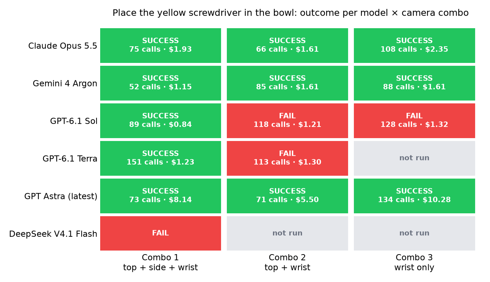

## TL;DR
- **All three cameras worked best.** With top-down + side + wrist cameras, **5 of 5** models succeeded. With top + wrist, 3 of 5 did,
  and with the wrist camera alone, 3 of 4. DeepSeek is excluded from these counts (only combo 1 was run, and it failed).
- **Fewer cameras meant more failed grasps.** The average was 0.4 failed grasps per run with 3 cameras, 1.0 with 2, and **3.0** with the
  wrist only. LLM calls rose from about 88 to about 114 per run, and active time from about 17 to about 26 minutes.
- **Claude Opus 5.5, Gemini 4 Argon and GPT Astra succeeded on all 3 combos.** GPT-6.1 Sol and Terra only succeeded with all three
  cameras. DeepSeek V4.1 Flash (max effort) failed combo 1 by going past the 200-call budget (280 calls); its other combos were not run.
- **Cost:** the 14 logged runs cost **$40.08** at the providers' own list prices, using 94.9 M input tokens (mostly cached) and 0.32 M
  output tokens.
  - Gemini 4 Argon was the cheapest reliable model at $1.15–1.61 per run.
  - GPT Astra cost $5.50–10.28 per run, 4–6× more than the others for the same result.
- **The approach was the same for every model:** write a small serial-control helper, then servo the arm with trial joint moves and
  camera snapshots. No model used the supplied CAD (STP) file for kinematics.

---

## Why this eval exists
LLM agents are increasingly asked to act in the physical world, but most "computer use" evals are screen-only. A robot task
adds things screens don't have: 3-D geometry, depth that's ambiguous from a single image, contact, gravity, and actions you
can't undo. The question here is simple and practical:

> **If you give a general-purpose coding agent more camera viewpoints, does it actually manipulate better, or does it just
> spend more tokens looking?**

To isolate that, everything except the camera set is held fixed:
- the same arm, objects, start pose, prompt and harness for every run;
- no robot-specific scaffolding, no pre-written control code, and no hints;
- each model gets the task **once** and runs unattended, with a 200-LLM-call budget.

The agent has to find the control repo, figure out the serial protocol, get images from the cameras, record the attempt,
do the task, and report its own token usage and cost.

## Setup
| | |
|---|---|
| Robot | Hiwonder NexArm follower (6 HX-30HM bus servos: shoulder_pan, shoulder_lift, elbow_flex, wrist_flex, wrist_roll, gripper), USB serial `/dev/cu.usbserial-110` @ 1 Mbps, LeRobot fork [`lerobot-nexarm`](https://github.com/Hiwonder-official/lerobot-nexarm) |
| Cameras | **Top-down** Logitech C922 · **lower-left side** Intel RealSense D415 (RGB) · **wrist** icspring UVC camera, all 640×480 |
| Scene | White table, grey bowl, yellow screwdriver beside it; the operator reset the screwdriver to the same spot before each run |
| Host | MacBook Pro (Apple silicon, macOS 26.2), ffmpeg 6.0, uv 0.8.14 |
| Frontend / recorder | [`setup/index.html`](setup/index.html) + [`setup/app.js`](setup/app.js) (3-camera browser view), [`setup/record.py`](setup/record.py) (composite MP4 + per-frame timing CSV + clip JSON) |
| Harness | `opencode run --auto --model openrouter/<model>#<effort> "$(cat eval-prompts/evalNN_….md)"`, prompt sent once |

**Camera combos**

| Combo | Top-down Logitech | Side RealSense | Wrist cam |
|---|:-:|:-:|:-:|
| 1 | ✅ | ✅ | ✅ |
| 2 | ✅ | ❌ | ✅ |
| 3 | ❌ | ❌ | ✅ |

**Models** (all through OpenRouter)

| Model | Effort | OpenRouter route |
|---|---|---|
| `anthropic/claude-opus-5.5` | medium | default |
| `google/gemini-4-argon` | medium | default; safety filters explicitly `OFF` (OpenRouter's default is also OFF) |
| `openai/gpt-6.1-sol` | medium | default (OpenAI) |
| `openai/gpt-6.1-terra` | medium | default (OpenAI) |
| `~openai/gpt-astra-latest` (resolved to `openai/gpt-6-astra`) | medium | default (OpenAI) |
| `deepseek/deepseek-v4.1-flash-1017` | **max** (it has no "medium"; OpenRouter silently maps medium→low) | pinned to Together / Fireworks / Baseten. DeepSeek's own endpoint is excluded by the account's data policy |

**Prompt.** [`setup/prompt.md`](setup/prompt.md) is the base; the 18 exact prompts are in [`eval-prompts/`](eval-prompts/).
They are identical except for the work-dir name, the three camera lines (`ENABLED` / `DISABLED`), and the model's price table.
Each prompt asks the model to:
- create a run directory;
- start the frontend (`start.sh`) and record with `record.py` from the first arm motion;
- cut off the disabled cameras;
- stop every process it started;
- export its own opencode session, compute tokens and cost, write a metadata JSON next to the clip, and ring a notification.

## Results

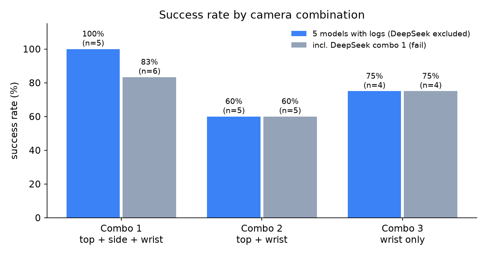

| Model | Combo | Outcome | LLM calls | Input tokens (cached) | Output tokens (reasoning) | Cost @ list price | Active min | Grasps (failed) |
|---|---|---|---:|---:|---:|---:|---:|---:|
| Claude Opus 5.5 | 1 | ✅ success | 75 | 4,396,513 (4,287,992) | 28,055 (8,096) | $1.93 | 11.9 | 1 (0) |
| Claude Opus 5.5 | 2 | ✅ success | 66 | 3,626,647 (3,534,894) | 23,184 (7,053) | $1.61 | 9.5 | 1 (0) |
| Claude Opus 5.5 | 3 | ✅ success | 108 | 6,605,582 (6,502,329) | 27,484 (9,839) | $2.35 | 15.9 | 3 (2) |
| Gemini 4 Argon | 1 | ✅ success | 52 | 5,062,523 (4,868,049) | 27,249 (13,473) | $1.15 | 12.8 | 1 (0) |
| Gemini 4 Argon | 2 | ✅ success | 85 | 8,751,037 (8,453,436) | 16,702 (0) | $1.61 | 18.4 | 1 (0) |
| Gemini 4 Argon | 3 | ✅ success | 88 | 7,379,152 (7,002,860) | 16,128 (0) | $1.61 | 20.6 | 1 (0) |
| GPT-6.1 Sol | 1 | ✅ success | 89 | 4,632,664 (4,551,605) | 17,971 (3,458) | $0.84 | 11.5 | 2 (1) |
| GPT-6.1 Sol | 2 | ❌ fail | 118 | 7,215,435 (7,103,452) | 21,991 (6,852) | $1.21 | 32.9 | 3 (2) |
| GPT-6.1 Sol | 3 | ❌ fail | 128 | 7,841,707 (7,741,198) | 29,019 (9,553) | $1.32 | 38.9 | 6 (6) |
| GPT-6.1 Terra | 1 | ✅ success | 151 | 11,827,464 (11,413,587) | 28,152 (8,520) | $1.23 | 33.6 | 2 (1) |
| GPT-6.1 Terra | 2 | ❌ fail | 113 | 10,526,238 (9,992,401) | 25,912 (8,027) | $1.30 | 14.2 | 2 (2) |
| GPT-6.1 Terra | 3 | — not run | — | — | — | — | — | — |
| GPT Astra (latest) | 1 | ✅ success | 73 | 5,524,890 (5,353,888) | 13,075 (3,605) | $8.14 | 14.9 | 1 (0) |
| GPT Astra (latest) | 2 | ✅ success | 71 | 3,638,637 (3,548,317) | 16,459 (3,190) | $5.50 | 20.5 | 2 (1) |
| GPT Astra (latest) | 3 | ✅ success | 134 | 7,856,235 (7,764,237) | 27,394 (11,089) | $10.28 | 28.8 | 5 (4) |
| DeepSeek V4.1 Flash | 1 | ❌ fail (280 calls > 200 budget; folder not included) | — | — | — | — | — | — |
| DeepSeek V4.1 Flash | 2 | — not run | — | — | — | — | — | — |
| DeepSeek V4.1 Flash | 3 | — not run | — | — | — | — | — | — |

**Column definitions**
- **Input tokens:** fresh input + cache reads + cache writes.
- **Output tokens:** visible output + reasoning.
- **Cost:** recomputed per LLM call at the provider's own published standard rate (see [Cost methodology](#cost-methodology)). It
  matches opencode's own figure to the cent for every run.
- **Active min:** time between LLM calls, with each gap capped at 5 min, so idle time after the work is excluded.
- **Grasps:** distinct gripper closures on the screwdriver; failed ones did not lift it.

Per-run machine-readable data: [`analysis/results.csv`](analysis/results.csv), [`analysis/results.json`](analysis/results.json),
[`analysis/outcomes.json`](analysis/outcomes.json), [`analysis/recordings.json`](analysis/recordings.json).

**By camera combo** (5 models with logs; DeepSeek excluded)

| Combo | Runs | Success | Mean LLM calls | Mean active min | Grasp attempts | Failed grasps / run | Median cost |
|---|---:|---:|---:|---:|---:|---:|---:|
| 1 · top + side + wrist | 5 | **5 (100%)** | 88 | 16.9 | 7 | **0.4** | $1.23 |
| 2 · top + wrist | 5 | 3 (60%) | 91 | 19.1 | 9 | 1.0 | $1.61 |
| 3 · wrist only | 4 | 3 (75%) | 114 | 26.1 | 15 | **3.0** | $1.98 |

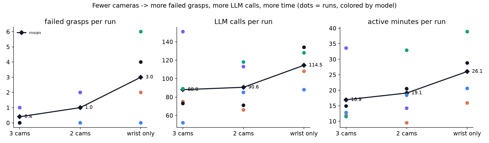

**By model**

| Model | Success | Total calls | Total cost (list price) | Notes |
|---|---|---:|---:|---|
| Claude Opus 5.5 | 3 / 3 | 249 | $5.89 | Only 2 failed grasps across all runs, both wrist-only |
| Gemini 4 Argon | 3 / 3 | 225 | $4.37 | **Zero failed grasps in every combo**; cheapest reliable model |
| GPT Astra (latest) | 3 / 3 | 278 | $23.93 | Reliable but 4–6× the cost; most inventive tooling |
| GPT-6.1 Sol | 1 / 3 | 335 | $3.36 | Cheapest success ($0.84, combo 1); failed both reduced-camera runs |
| GPT-6.1 Terra | 1 / 2 | 264 | $2.53 | Highest call count of any success (151); combo 3 not run |
| DeepSeek V4.1 Flash (max) | 0 / 1 | — | — | Combo 1 exceeded the call budget; combos 2 and 3 not run |

### More charts
| | |
|---|---|
| 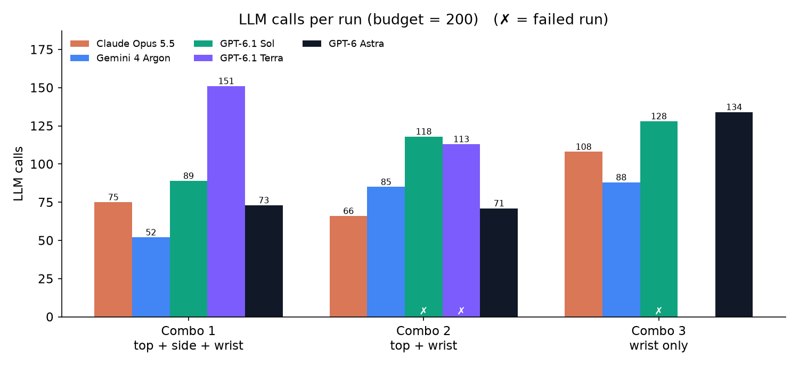 | 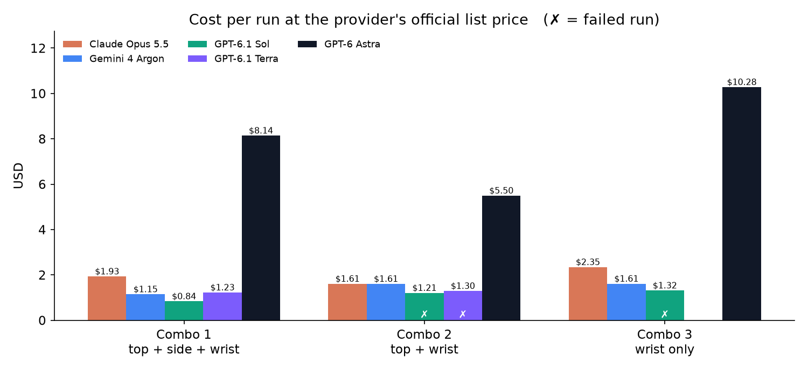 |
| 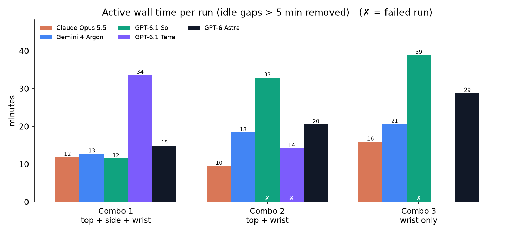 | 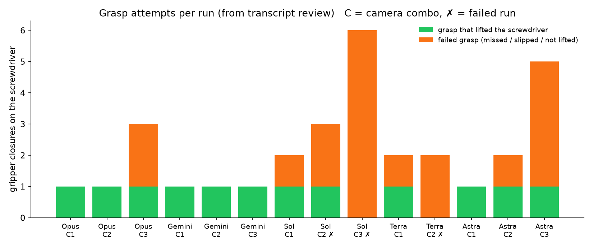 |
| 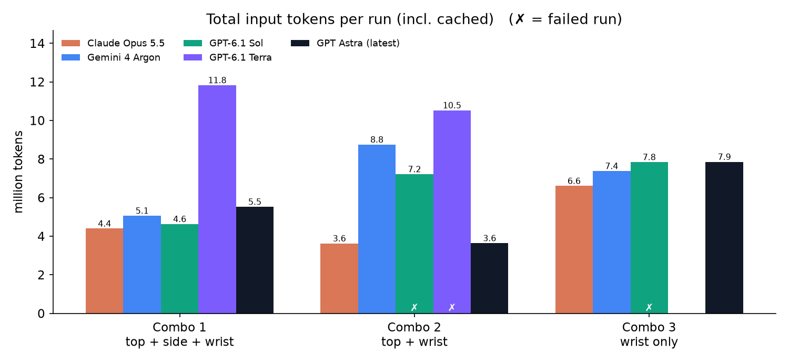 | 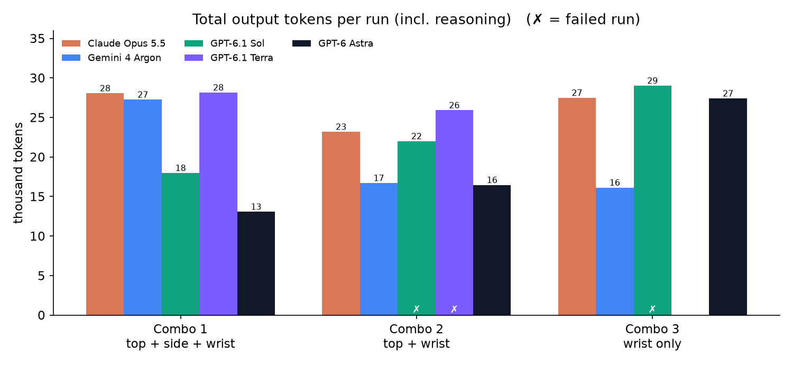 |

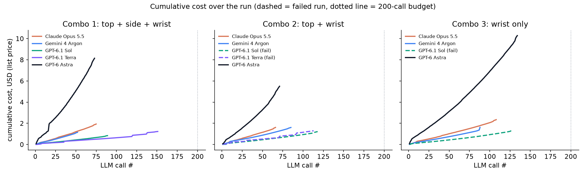
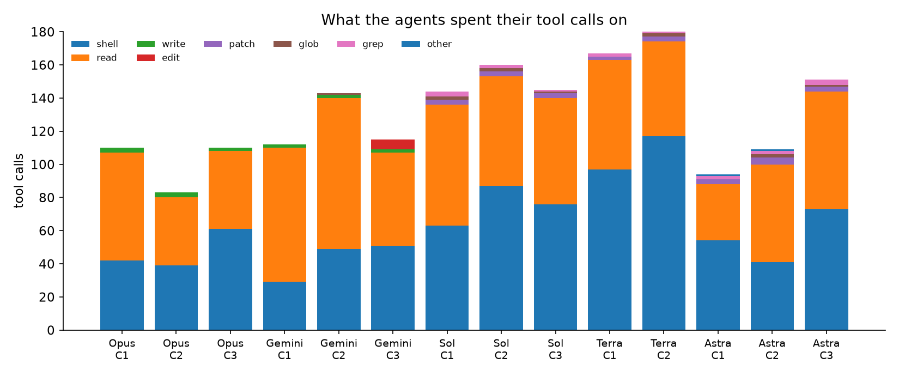

### Final state of every run
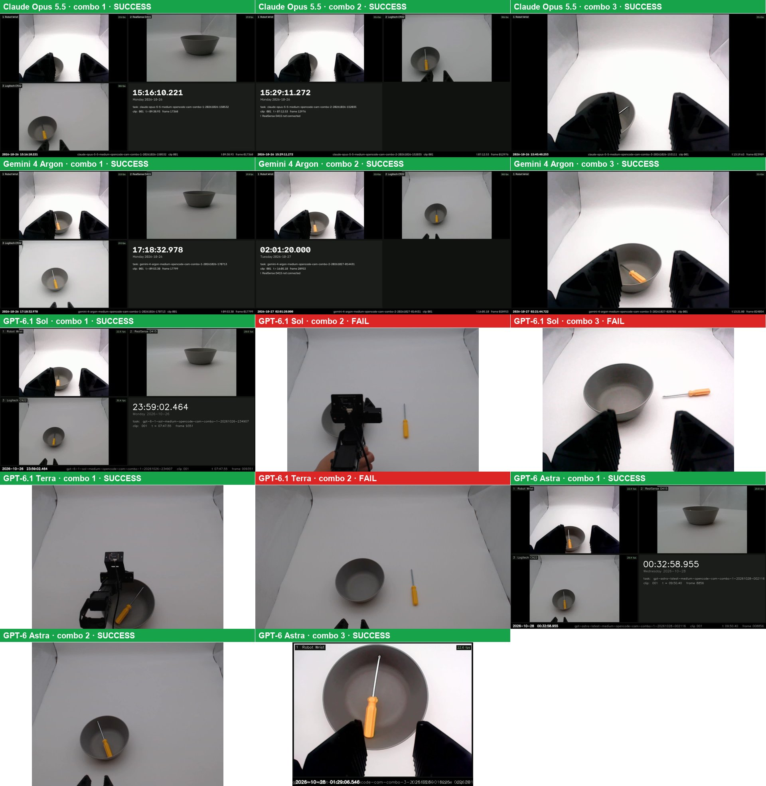

For the 5 runs whose screen recording stalled (see [Incidents](#incidents-and-caveats)), the image shown is the model's own
final top-down or wrist still from its work dir.

## How the models approached the task
The full narrative for every run, with call numbers and timestamps, is in **[docs/RUN_NARRATIVES.md](docs/RUN_NARRATIVES.md)**.
Every individual LLM call is in `runs/<run>/session/timeline.md`.

**The common pattern:**
1. **Read first.** Every run started by reading `start.sh`, `record.py` and the LeRobot NexArm driver (CMD 96/97/98 over a 1 Mbps
   serial frame protocol).
2. **Build tooling.** It wrote a small helper: a persistent HTTP robot server (Opus, Sol), a one-shot CLI (Gemini, Astra, Terra), plus
   an ffmpeg snapshot script.
3. **Learn the arm empirically.** It moved one joint a little, took a snapshot, and inferred which way it moved. Nobody parsed the STP CAD
   file for real kinematics; a few read its header.
4. **Grasp.** It closed the gripper and treated a stall short of the target (for example, target 2650 → actual 2491) as "contact with the
   handle". Then it lifted and checked whether the screwdriver came along.
5. **Place, verify, clean up.** Pan to the bowl, lower, open, check the images, return to start, stop processes, and write the metadata.

**How cameras changed behaviour**
- **Three cameras:** the side RealSense view was used to judge fingertip height above the table, and to confirm a lift with "lifted clear"
  checks (Sol, Gemini, Astra). Grasps rarely failed (2 failures in 5 runs).
- **Wrist only:** depth became the main problem. Models repeatedly closed above the handle ("the gripper did not stall"), pressed into the
  table, or nudged the screwdriver. Sol closed 6 times and never lifted it; Astra needed 5 attempts and Opus 3. Gemini was the exception:
  it got it first time with the wrist only.
- **Two cameras (top + wrist):** the top view helped with x/y alignment but not height. Both Sol and Terra failed here, while Opus,
  Gemini and Astra succeeded.

**Per model, in one line each**
- **Claude Opus 5.5:** a disciplined persistent-server design, few calls and clean recovery. It even found and killed a stray process from
  the previous run that was holding the serial port.
- **Gemini 4 Argon:** the fewest calls and no failed grasps. On combo 3 it edited the shared `app.js` to blank the disabled cameras, then
  restored it.
- **GPT-6.1 Sol:** strong pixel-coordinate planning with all three cameras. Without them it struggled: in combo 2 the release missed
  the bowl, and in combo 3 none of its 6 grasps lifted the screwdriver.
- **GPT-6.1 Terra:** many small steps (151 calls on combo 1) and good recovery from a first failed grasp. With two cameras it gave up after
  two grasp sequences rather than risk a lower approach.
- **GPT Astra:** the most inventive tooling:
  - drove Chrome over the DevTools protocol when AppleScript was blocked;
  - served a modified `app.js` through a `sitecustomize` hook instead of editing the shared file;
  - built its own composite recorder;
  - recorded a separate evidence clip when its screen recording froze.

  It reasoned in millimetres about geometry and succeeded on all three combos, at about 5× the cost.

## Video clips
Each run has a 30-second clip: the **last 240 seconds of the main recording sped up 8×** (H.264, 1280 px, no audio). For the 5 runs where
the screen capture stalled, the clip covers the last 240 s *before* the stall.

| Run | Clip | Source window (s) |
|---|---|---|
| Opus · combo 1 | [clip](runs/claude-opus-5-5-medium-opencode-cam-combo-1-20261026-150532/clips/claude-opus-5-5-medium-opencode-cam-combo-1-20261026-150532_last240s_8x.mp4) | 339–579 |
| Opus · combo 2 | [clip](runs/claude-opus-5-5-medium-opencode-cam-combo-2-20261026-152035/clips/claude-opus-5-5-medium-opencode-cam-combo-2-20261026-152035_last240s_8x.mp4) | 193–433 |
| Opus · combo 3 | [clip](runs/claude-opus-5-5-medium-opencode-cam-combo-3-20261026-153111/clips/claude-opus-5-5-medium-opencode-cam-combo-3-20261026-153111_last240s_8x.mp4) | 560–800 |
| Gemini · combo 1 | [clip](runs/gemini-4-argon-medium-opencode-cam-combo-1-20261026-170713/clips/gemini-4-argon-medium-opencode-cam-combo-1-20261026-170713_last240s_8x.mp4) | 354–594 |
| Gemini · combo 2 | [clip](runs/gemini-4-argon-medium-opencode-cam-combo-2-20261027-014431/clips/gemini-4-argon-medium-opencode-cam-combo-2-20261027-014431_last240s_8x.mp4) | 726–966 |
| Gemini · combo 3 | [clip](runs/gemini-4-argon-medium-opencode-cam-combo-3-20261027-020702/clips/gemini-4-argon-medium-opencode-cam-combo-3-20261027-020702_last240s_8x.mp4) | 562–802 |
| Sol · combo 1 | [clip](runs/gpt-6-1-sol-medium-opencode-cam-combo-1-20261026-234907/clips/gpt-6-1-sol-medium-opencode-cam-combo-1-20261026-234907_last240s_8x.mp4) | 228–468 |
| Sol · combo 2 | [clip](runs/gpt-6-1-sol-medium-opencode-cam-combo-2-20261027-000138/clips/gpt-6-1-sol-medium-opencode-cam-combo-2-20261027-000138_last240s_8x.mp4) | 0–222 (stalled at 223) |
| Sol · combo 3 | [clip](runs/gpt-6-1-sol-medium-opencode-cam-combo-3-20261027-003536/clips/gpt-6-1-sol-medium-opencode-cam-combo-3-20261027-003536_last240s_8x.mp4) | 0–220 (stalled at 221) |
| Terra · combo 1 | [clip](runs/gpt-6-1-terra-medium-opencode-cam-combo-1-20261027-215348/clips/gpt-6-1-terra-medium-opencode-cam-combo-1-20261027-215348_last240s_8x.mp4) | 0–227 (stalled at 228) |
| Terra · combo 2 | [clip](runs/gpt-6-1-terra-medium-opencode-cam-combo-2-20261027-222824/clips/gpt-6-1-terra-medium-opencode-cam-combo-2-20261027-222824_last240s_8x.mp4) | 0–223 (stalled at 224) |
| Astra · combo 1 | [clip](runs/gpt-astra-latest-medium-opencode-cam-combo-1-20261028-002116/clips/gpt-astra-latest-medium-opencode-cam-combo-1-20261028-002116_last240s_8x.mp4) | 351–591 |
| Astra · combo 2 | [clip](runs/gpt-astra-latest-medium-opencode-cam-combo-2-20261028-004041/clips/gpt-astra-latest-medium-opencode-cam-combo-2-20261028-004041_last240s_8x.mp4) | 6–246 (stalled at 247) |
| Astra · combo 3 | [clip](runs/gpt-astra-latest-medium-opencode-cam-combo-3-20261028-010225/clips/gpt-astra-latest-medium-opencode-cam-combo-3-20261028-010225_last240s_8x.mp4) | 1269–1509 |

The full-length recordings (MP4, up to 280 MB each) are kept off-repo. Their clip JSON, per-frame timing CSV and session JSON
**are** included in each `runs/<run>/recording/<clip folder>/`.

## Cost methodology
Cost is recomputed **per LLM call** from the token counts opencode recorded, at each provider's own published standard
API price. It is not OpenRouter's billed amount, and not flex, batch or discounted rates. For OpenAI, the >272K-token prompt tier
is applied per call; no call crossed it.

| Model | Input | Cache read | Cache write | Output (incl. reasoning) | Source |
|---|---:|---:|---:|---:|---|
| Claude Opus 5.5 | $4.00 | $0.20 | $5.00 | $20.00 | [Anthropic pricing](https://platform.claude.com/docs/en/about-claude/pricing) |
| Gemini 4 Argon | $2.00 | $0.10 | — (implicit cache) | $10.00 | [Gemini API pricing](https://ai.google.dev/gemini-api/docs/pricing) (through 2026-11-30) |
| GPT-6.1 Sol | $2.00 | $0.10 | $2.50 | $10.00 | [OpenAI pricing](https://developers.openai.com/api/docs/pricing) |
| GPT-6.1 Terra | $1.00 | $0.05 | $1.25 | $5.00 | OpenAI pricing |
| GPT-6 Astra | $10.00 | $1.00 | $12.50 | $50.00 | OpenAI pricing |
| DeepSeek V4.1 Flash | $0.30 (peak) / $0.15 | $0.006 / $0.003 | — | $1.20 / $0.60 | [DeepSeek pricing](https://api-docs.deepseek.com/quick_start/pricing/) |

All prices are USD per 1M tokens. The script is [`analysis/analyze_sessions.py`](analysis/analyze_sessions.py).

## Incidents and caveats
Things that went wrong during the experiment, so the results can be read honestly:
1. **Shoulder servo fault (Oct 26, morning).** `shoulder_lift` read a frozen 2633 and didn't respond to commands. The first Gemini and
   Opus combo-1 attempts were invalidated and rerun after the servo was fixed and the home pose re-saved. Afterwards a per-joint movement
   check was added before runs.
2. **A model edited a shared file.** A superseded Gemini combo-2 attempt (Oct 26 18:01) edited the shared `app.js` to hide the RealSense
   and didn't revert it. Browsers then cached the edited copy. It was restored byte for byte, `start.sh` now serves with
   `Cache-Control: no-store`, and that attempt was rerun.
   - In the included runs, Gemini combo 3 and Sol combo 3 both edited `app.js` but restored it.
   - Astra combo 3 served its own modified copy instead of editing the shared file.
3. **Arm USB disconnect** between Oct 26 18:23 and 21:36. A Gemini combo-3 attempt and a GPT-6.1 Sol combo-1 attempt ran with no arm
   connected; both were rerun.
4. **Screen-capture stalls.** Five runs recorded the screen (`record.py --source screen`) instead of the cameras, which is a literal reading
   of "record the frontend". Each capture stopped after 220–247 s, most likely because the unattended display slept. Those videos show
   only the first ~3.7 minutes, so their outcomes were verified from the model's final camera stills and transcript. The runs are Sol 2,
   Sol 3, Terra 1, Terra 2 and Astra 2.
5. **Competing camera process.** An unrelated `camera_server.py` from another project was streaming the C922 and the wrist camera until
   Oct 26 ~21:50. It may explain the wrist-camera lag reported during the very first attempts. Every run before that time was affected
   equally: all Opus runs and Gemini combo 1.
6. **Leftover processes between runs.** Several models left a robot server running (some detached themselves), which held the serial
   port. One model (Opus combo 2) cleaned up the previous run's leftovers itself. A "stop every process you started" line was added to
   the prompt.
7. **Reasoning effort is not identical.** DeepSeek ran at **max**, all others at medium.
8. **Sample size is 1 run per cell.** The camera trend is consistent across metrics, but the cells are single runs.
9. **Not run / not included.** Terra combo 3 and DeepSeek combos 2 and 3 were not run. The DeepSeek combo-1 folder was left out because its
   session export is 228 MB and I did not review it; it can be added. Only the latest run per model × combo is included; superseded
   attempts are not.
10. **Outcome verification.** Outcomes are verified from images (final recorded frame, or the model's final still). The models'
    self-reported metadata JSONs were written before their final reply, so their token and cost numbers are slightly lower than the
    totals here. `stats.json` is computed from the complete session.
11. **Gemini combo-3 wall time** includes about 89 idle minutes after the work was done; use "Active min".

## Repository layout
```
README.md                      this file
docs/RUN_NARRATIVES.md         step-by-step account of every run (planning, scripts, attempts, failures, recoveries)
docs/figures/                  all charts + final-state gallery
analysis/
  analyze_sessions.py          session export -> slim export, timeline.md, stats.json, results.csv/json
  make_charts.py               results -> charts, summary_table.md, active_time.json
  outcomes.json                verified outcome + grasp counts per run
  results.csv / results.json   per-run tokens, cost, calls, tool usage
  recordings.json              which recording/clip belongs to which run, stall points
eval-prompts/                  the 18 exact prompts sent to opencode
setup/                         base prompt, frontend (index.html/app.js/style.css), start.sh, record.py, NexArm STP,
  orchestration-scripts/       home-pose / joint-check helper and the early automated orchestrator
runs/<model>-opencode-cam-combo-<n>-<datetime>/
  model_workdir/               everything the model created (control scripts, snapshots, its metadata JSON)
  recording/<clip folder>/     record.py output without the MP4 (clip JSON, frame CSV, session JSON, model evidence)
  session/timeline.md          every LLM call: text, tool call, tool output, tokens, cost
  session/stats.json           counts, tokens, cost at list price, tool usage, files written
  session/opencode_session_export.slim.json   full opencode transcript (base64 images replaced by stubs)
  clips/                       30 s 8x clip of the last 240 s + final frame / final evidence image
```

## Reproduce the analysis
```bash
# full session exports (not committed: they embed every camera frame as base64, up to 228 MB each)
opencode session export <session_id> > _raw_exports/<run_id>.json   # session ids are in analysis/recordings.json
python3 analysis/analyze_sessions.py
uv run analysis/make_charts.py
```
